# Genome browsers on ZFIN: where they appear and what goes wrong

Captured 2026-10-23 from production, `https://franklin.zfin.org/`, with Playwright (Chromium, 1400 x 1000 viewport, each page given about 10 seconds for the browser components to draw). The IDs were chosen from the dev database and then checked on production. Counts of genes and features come from the dev database, so they will differ a little in production.

Why this file exists: decision D4 in [`../assembly-blast-radius.md`](../assembly-blast-radius.md), which asks how the genome browser should behave once GRCz13ab has data. Each place below picks its assembly on its own, so the examples are the evidence.

Screenshots are in [`images/`](images/). Code references are to the `annotation-status-view` branch, which has the same genome browser code as `main`.

## Contents

1. [Where a genome browser shows up](#1-where-a-genome-browser-shows-up)
2. [Mainline cases](#2-mainline-cases)
3. [Edge cases](#3-edge-cases)
4. [The issues, with their evidence](#4-the-issues-with-their-evidence)
5. [Not captured](#5-not-captured)
6. [Reproduction notes](#6-reproduction-notes)

---

## 1. Where a genome browser shows up

| # | Where | Example on production | How the assembly is chosen (code) |
|---|---|---|---|
| 1 | Gene page, **Sequences** | [`ZDB-GENE-990415-72#sequences`](https://franklin.zfin.org/ZDB-GENE-990415-72#sequences) | `GeneViewController`: best assembly in `marker_assembly` must be named `GRCz12tu`, and the gene needs exactly one `ZFIN` or `ZfinGbrowseStartEndLoader` location on it (the landmark). |
| 2 | Gene page, **Transcripts** | [`ZDB-GENE-990415-72#transcripts`](https://franklin.zfin.org/ZDB-GENE-990415-72#transcripts) | `TranscriptService` fixes `GRCZ11`. |
| 3 | **Pseudogene** page | [`ZDB-GENEP-041008-30`](https://franklin.zfin.org/ZDB-GENEP-041008-30) | `PseudoGeneViewController`: first `ZFIN` or `NCBILoader` location. The image is built before any assembly check. The name check only guards the links row. |
| 4 | **Clone** page | [`ZDB-BAC-030616-1`](https://franklin.zfin.org/ZDB-BAC-030616-1) | `CloneViewController` fixes `GRCZ11`. |
| 5 | **STR** page (morpholino, CRISPR, TALEN) | [`ZDB-CRISPR-131024-1`](https://franklin.zfin.org/ZDB-CRISPR-131024-1) | `SequenceTargetingReagentViewController`: prefers GRCz12tu, falls back to GRCz11 for that STR. The only page that chooses per object. |
| 6 | **Feature** page | [`ZDB-ALT-030922-2`](https://franklin.zfin.org/ZDB-ALT-030922-2) | `FeatureService.getGbrowseImage`: the feature's first location, then a switch on its assembly (Zv9, GRCz10, GRCz12tu, otherwise GRCz11). |
| 7 | **Mapping detail** | [`/action/mapping/detail/ZDB-GENE-990415-72`](https://franklin.zfin.org/action/mapping/detail/ZDB-GENE-990415-72) | `MappingDetailController`: first `ZFIN` location (GRCz12tu), otherwise the `ZfinGbrowseStartEndLoader` one (GRCz11). The build comes from the source, not the assembly. |
| 8 | **Standalone JBrowse2** | [`/action/jbrowse2`](https://franklin.zfin.org/action/jbrowse2) | `JBrowse2Controller`: a React app with GRCz11 only. |
| 9 | Navigation, **Genomics, Genome Browsers, ZFIN** | every page | External JBrowse on AWS Amplify with `assembly=GRCz12tu` and a fixed location written into the URL (`pageHeader.tag`). |
| 10 | Footer, **Genomics, ZFIN** | every page | Links to `/action/jbrowse2` (item 8). Present on production; I did not find it in the templates of this checkout. |
| 11 | **Search "related data"** links | `/action/jbrowse/byName?name=<id>` | `RelatedDataService`, then `JBrowseController` redirects to the old JBrowse v1 on GRCz11. |
| 12 | "Genome Browsers" **link rows** under items 1, 2, 3, 7 | same pages | `MappingService.getJBrowserBrowserLinks`: names links only for GRCz12tu and GRCz11. Links go to Amplify with `assembly=` in the URL, plus NCBI Map Viewer, Ensembl and UCSC. |
| 13 | **BLAST** results (transcript hits) | none: the image is built but no page renders it (checked on production 2026-10-28) | `BlastResultMapper`: default build (GRCz12tu), landmark from GRCz11. |

The embedded images are the React component `Jbrowse2Image`. It takes `data-build` from the page and looks that name up in `config-jbrowse2.json`, which already lists four assemblies (**GRCz12tu, GRCz11, GRCz10, Zv9**) with 39 tracks that each name their assemblies. An unknown build falls back to the first assembly in the file. GRCz13ab is not in it.

---

## 2. Mainline cases

These are the common, working cases. Build and landmark are read from each component's `data-build` and `data-landmark`.

### M1. Gene with a GRCz12tu location: Sequences (fgf8a)

[`ZDB-GENE-990415-72`](https://franklin.zfin.org/ZDB-GENE-990415-72#sequences). Gene page "Genome Assembly: GRCz12tu". The Sequences section has a **GRCz12tu** browser at `13:31859449..31889783`, with ZFIN Gene and RefSeq tracks, and a "Genome Browsers" row with **NCBI Map Viewer** and **ZFIN**.

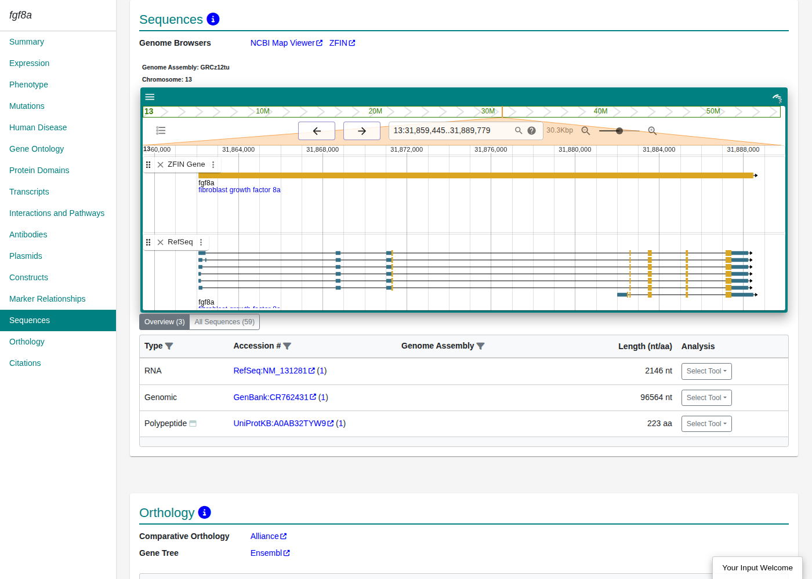

### M2. The same gene: Transcripts

The Transcripts section on the same page shows a different browser: **GRCz11** at `13:28494763..28502313`, labeled "Genome Assembly: GRCz11". One page therefore shows the same gene in two assemblies, 3.4 Mb apart on chromosome 13, with nothing explaining the difference.

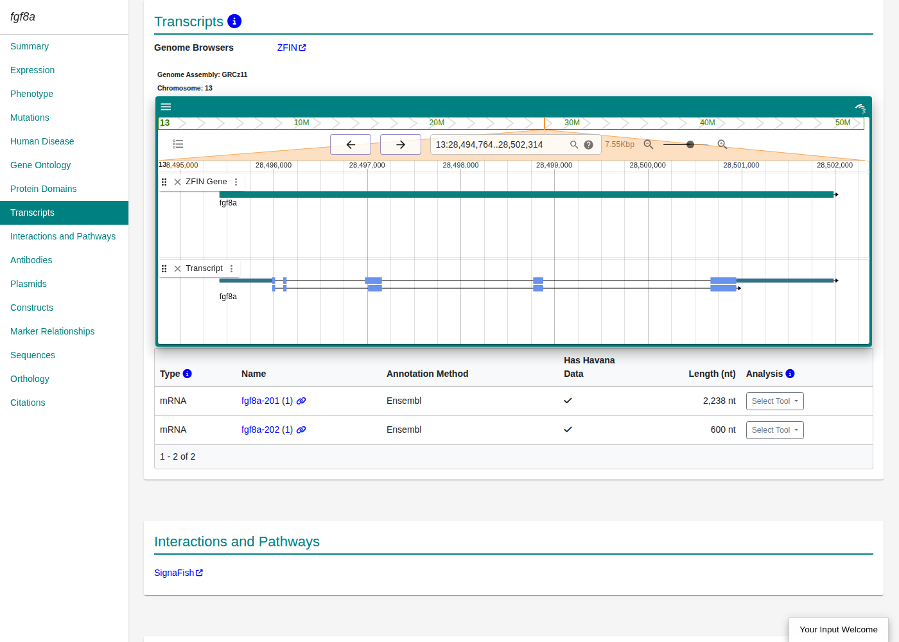

### M3. The same gene: Mapping detail

A **GRCz12tu** browser, centered range `13:31625275..32125275`, and a "Genome Browser" table that lists every location with its assembly: ZFIN and NCBI Map Viewer on GRCz12tu, Ensembl, NCBI Map Viewer and UCSC on GRCz11, and Vega on **GRCv10**.

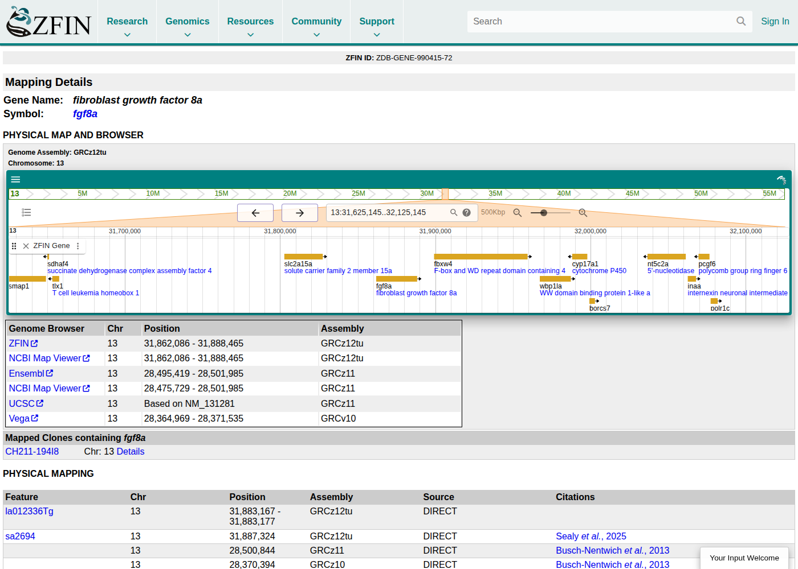

### M4. Pseudogene on GRCz12tu and GRCz11

[`ZDB-GENEP-041008-30`](https://franklin.zfin.org/ZDB-GENEP-041008-30) (si:dkey-122c11.2p). "Genome Assembly: GRCz12tu". Two browsers, like a gene: **GRCz11** at `4:49224182..49225984` and **GRCz12tu** at `6:20824975..20828766`. The two assemblies put it on different chromosomes.

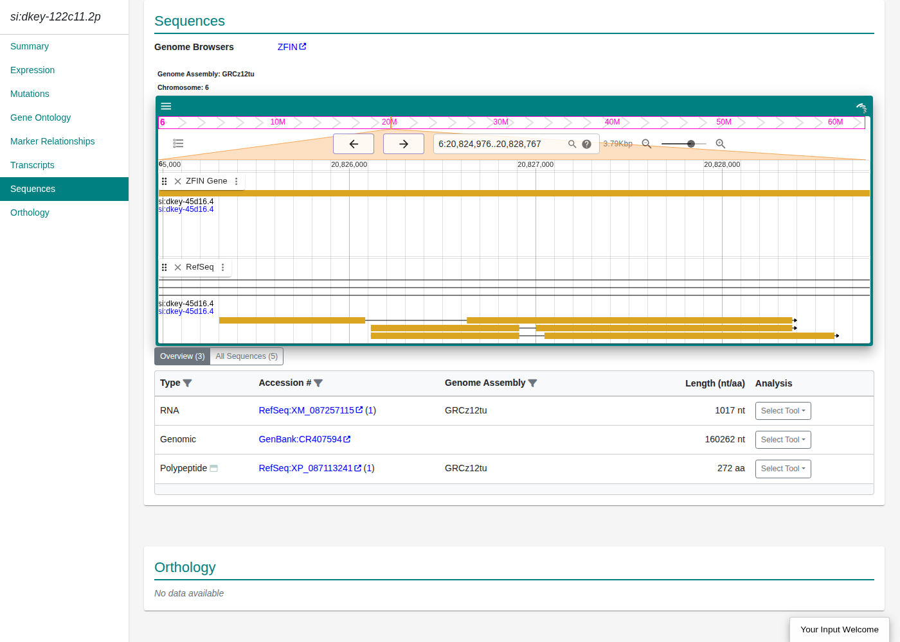

### M5. Clone

[`ZDB-BAC-030616-1`](https://franklin.zfin.org/ZDB-BAC-030616-1) (CH211-101N13). One **GRCz11** browser at `13:24362967..24602432`. All 26,513 clones with locations in dev are GRCz11 only, so the fixed build matches the data.

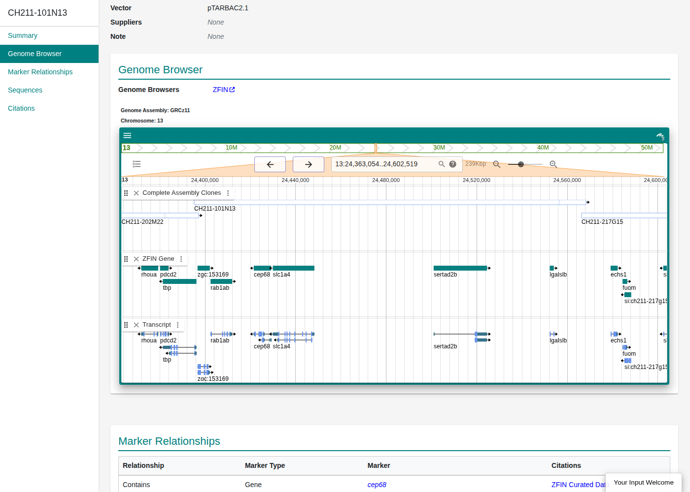

### M6. STR on both assemblies (morpholino and CRISPR)

[`ZDB-MRPHLNO-041108-1`](https://franklin.zfin.org/ZDB-MRPHLNO-041108-1) (MO1-pax8): one **GRCz12tu** browser at `5:78861029..78872458`. [`ZDB-CRISPR-131024-1`](https://franklin.zfin.org/ZDB-CRISPR-131024-1) (CRISPR1-etsrp): one **GRCz12tu** browser at `16:46431020..46437109`. Both also have GRCz11 locations, and the page prefers GRCz12tu.

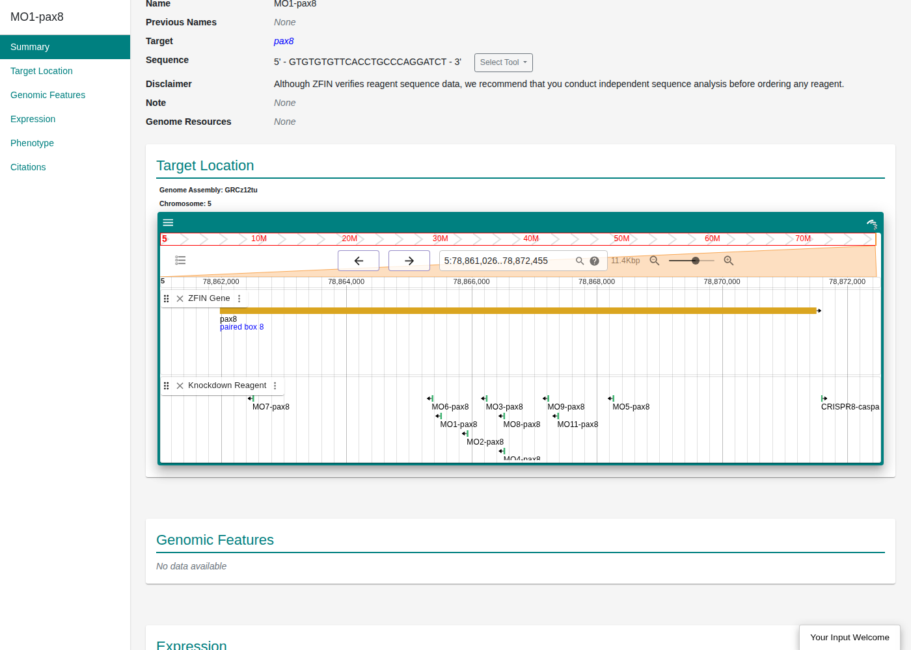
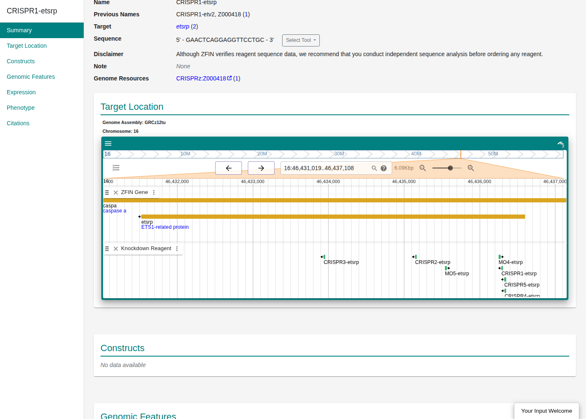

### M7. Feature on four assemblies

[`ZDB-ALT-030922-2`](https://franklin.zfin.org/ZDB-ALT-030922-2) (hu894) has locations on Zv9, GRCz10, GRCz11 and GRCz12tu. One **GRCz12tu** browser at `17:20694341..20763049`. The page picks one of four; there is no way to see the others.

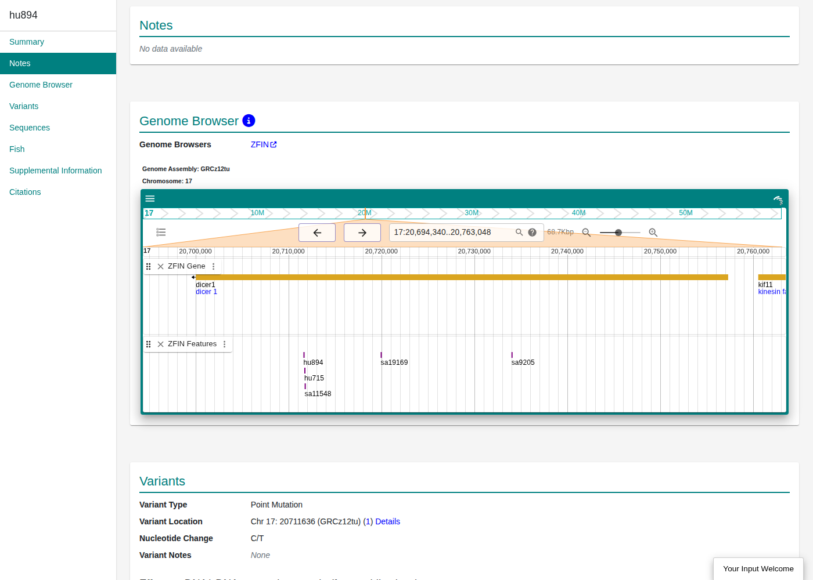

### M8. Standalone JBrowse2

[`/action/jbrowse2`](https://franklin.zfin.org/action/jbrowse2) opens **GRCz11** at `18:20,426,412..20,504,811` with ZFIN Gene, Transcript and ZFIN Features tracks and a track picker. It is GRCz11 whatever the data.

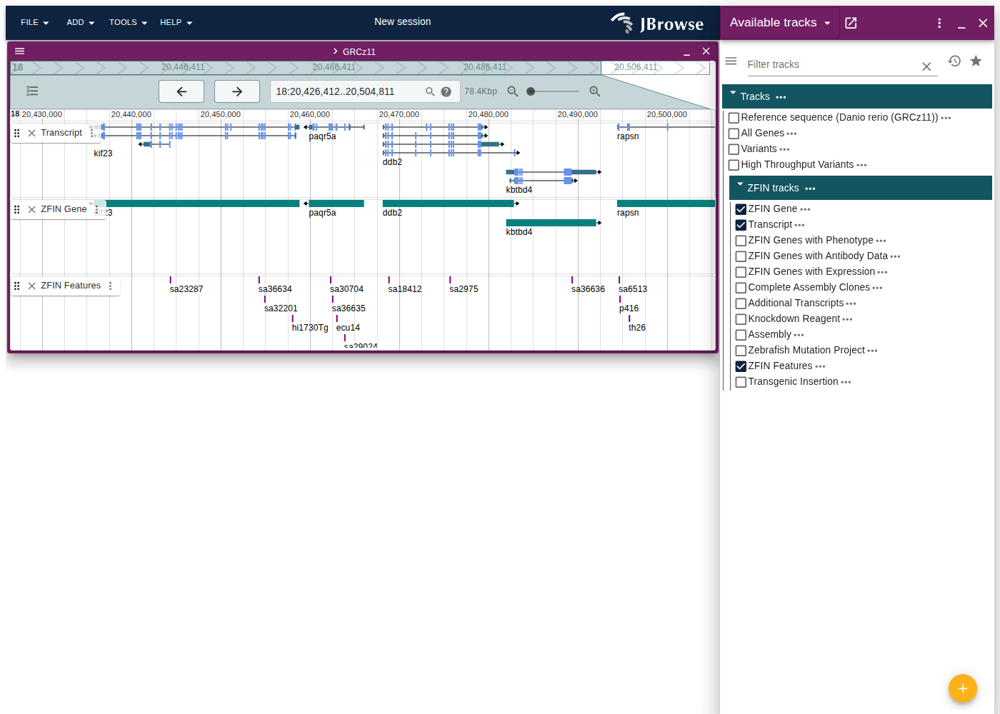

### M9. Navigation and footer

The **Genomics, Genome Browsers** menu starts with an external **ZFIN** link (Amplify, GRCz12tu, a fixed location). The footer's **Genomics, ZFIN** link goes to `/action/jbrowse2`, which is GRCz11. Two different "ZFIN" genome browsers sit one click from every page, on different assemblies.

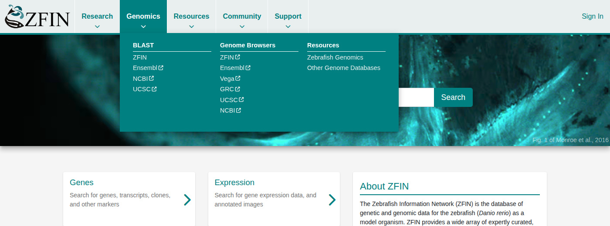
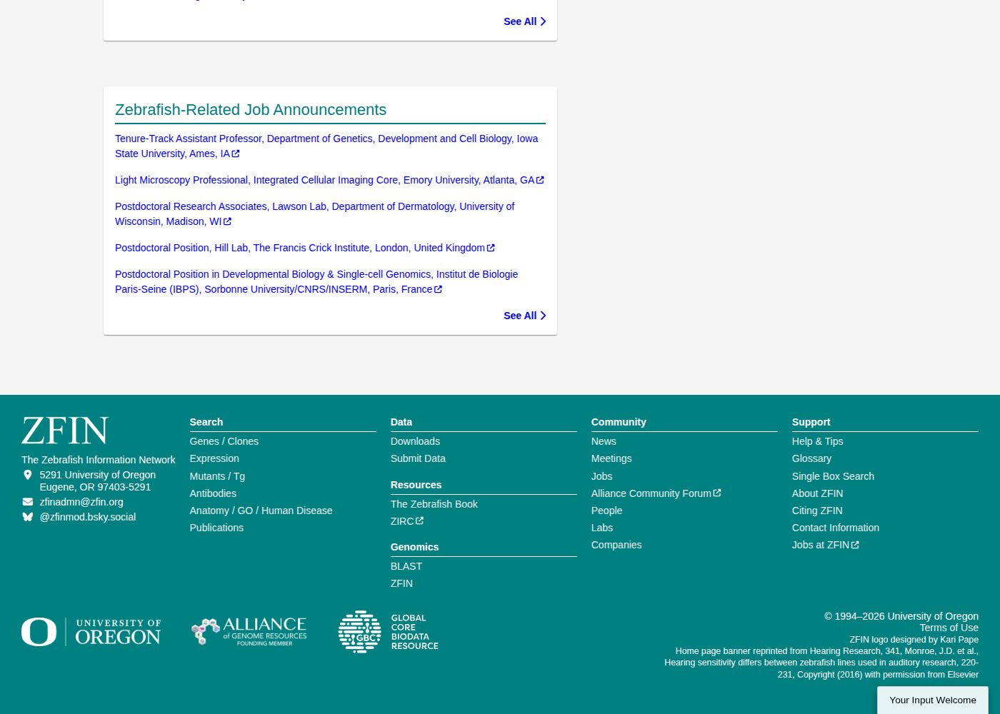

---

## 3. Edge cases

"Dev genes" is the count in the dev database of genes (or features) in the same situation.

### E1. Two landmarks: no browser in Sequences (marchf4b)

[`ZDB-GENE-041210-304`](https://franklin.zfin.org/ZDB-GENE-041210-304#sequences). "Genome Assembly: GRCz12tu", but the Sequences section has no browser, because it has two landmark locations on GRCz12tu and the page needs exactly one. The only browser is the GRCz11 one in Transcripts (`9:52487933..52542057`). Dev genes: 7.

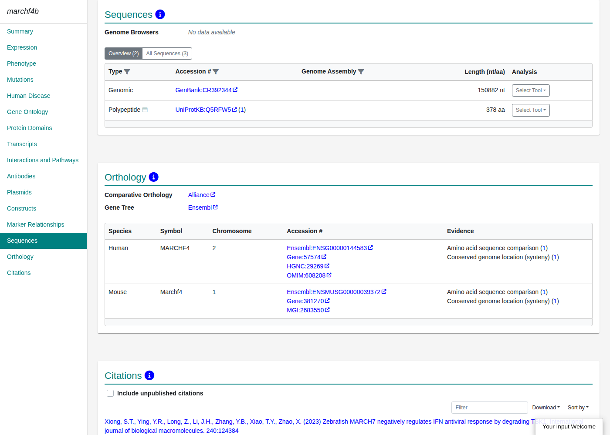

### E2. Best assembly is GRCz11: nothing in Sequences, GRCz11 on Mapping detail (mhc1uca)

[`ZDB-GENE-010112-3`](https://franklin.zfin.org/ZDB-GENE-010112-3#sequences). "Genome Assembly: GRCz11". Sequences shows **"Genome Browsers: No data available"**. The Transcripts section has a GRCz11 browser at `19:7042850..7051873`, and Mapping detail shows a GRCz11 browser at `19:6797557..7297557`. The name check in `GeneViewController` requires GRCz12tu, so a GRCz11-only gene never gets a Sequences browser. Dev genes: 2,062 with one landmark (2,184 with GRCz11 as their best assembly).

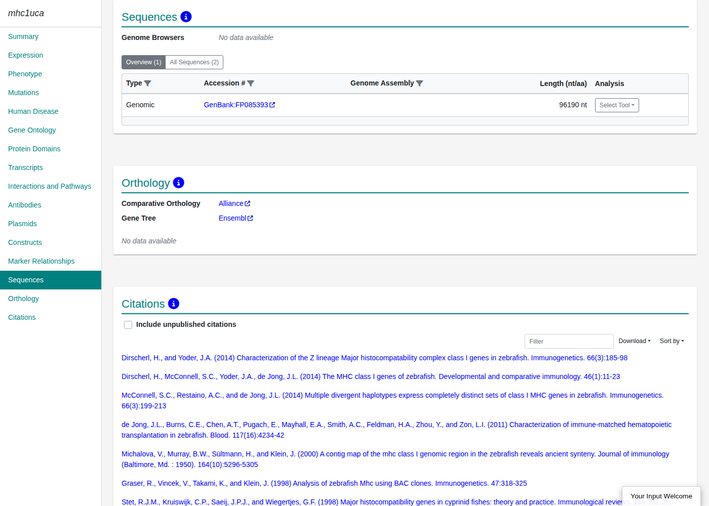
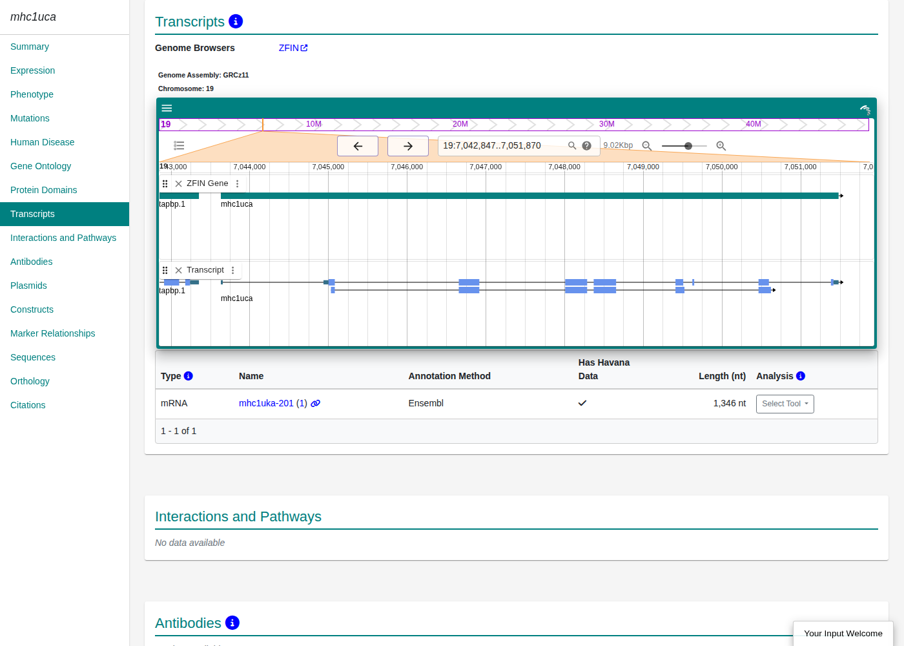
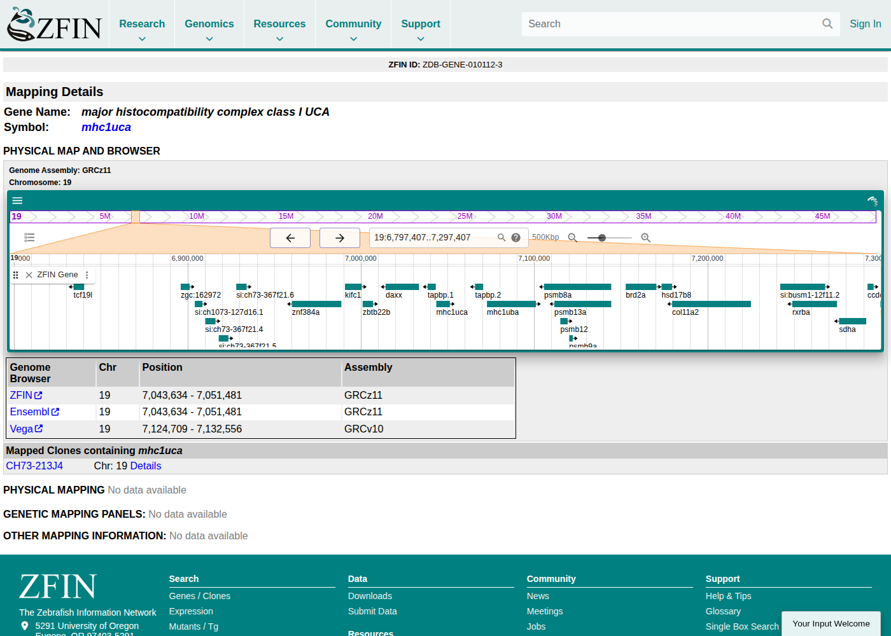

### E3. The stored assembly disagrees with the locations (bicc1b)

[`ZDB-GENE-080522-3`](https://franklin.zfin.org/ZDB-GENE-080522-3#sequences). The gene page says **"Genome Assembly: GRCz11"** and Sequences shows no browser. Its Mapping detail shows a **GRCz12tu** browser (`12:7621725..8121725`) and a table row "ZFIN 12 7,840,071 - 7,903,380 GRCz12tu". The page's "Genome Assembly" comes from the `marker_assembly` copy, which lacks the GRCz12tu row that the location table has. Dev genes: 1 (the only drift between the two for GRCz12tu).

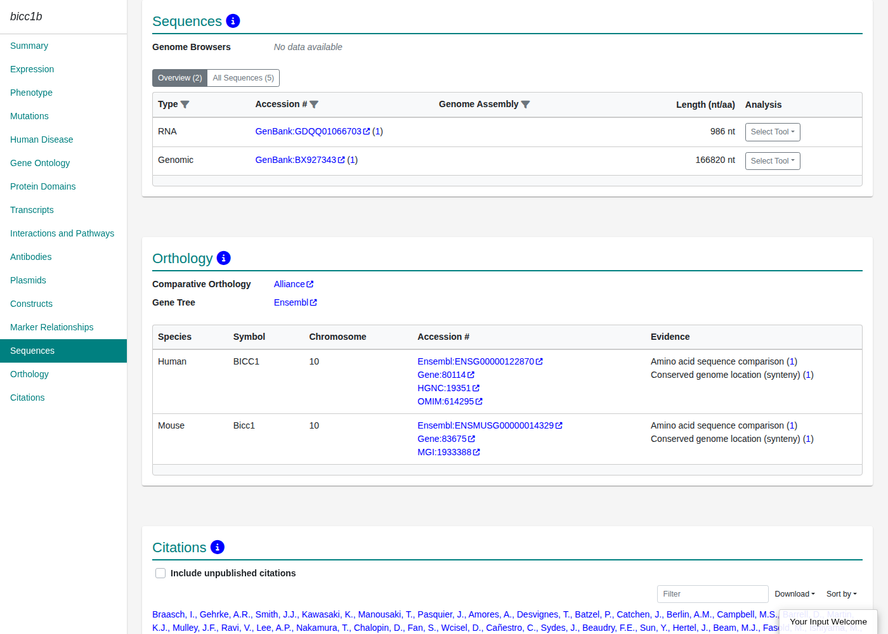
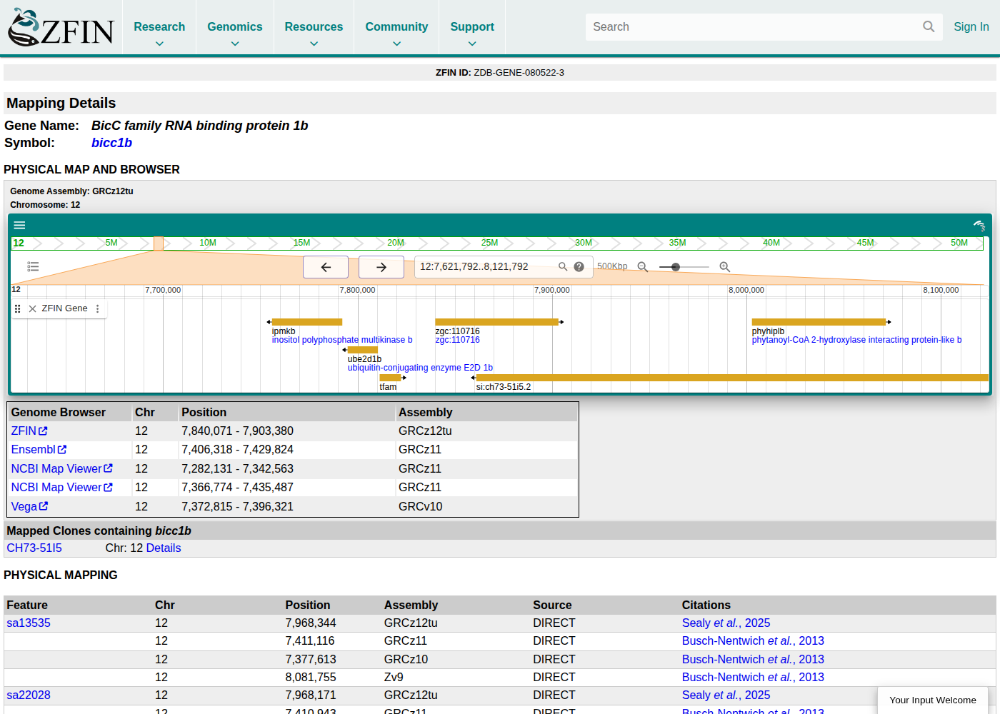

### E4. Locations but no `marker_assembly` row: Unknown (id:ibd2170)

[`ZDB-GENE-000607-14`](https://franklin.zfin.org/ZDB-GENE-000607-14#sequences). "Genome Assembly: Unknown", no browser anywhere on the page, although the gene has GRCz11 locations in the location table. Dev genes: 3,497 with only GRCz11 locations and no `marker_assembly` row.

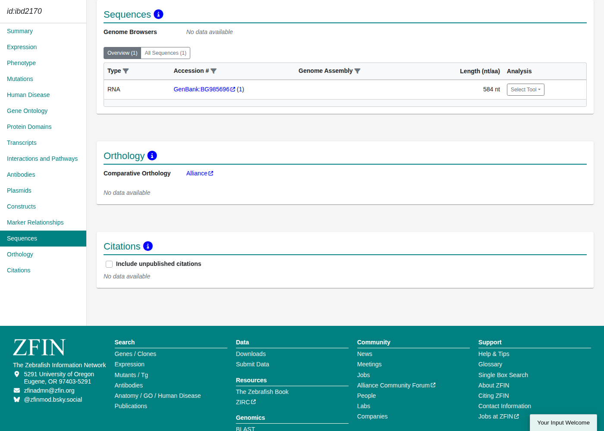

### E5. Only a GRCv10 location: Unknown (si:ch211-237b12.4)

[`ZDB-GENE-030131-8765`](https://franklin.zfin.org/ZDB-GENE-030131-8765#sequences). "Genome Assembly: Unknown", no browser. Its only location is the legacy label GRCv10. Dev genes: 1,515. GRCv10 is also visible to users: the Mapping detail table for fgf8a lists a "Vega ... GRCv10" row (M3).

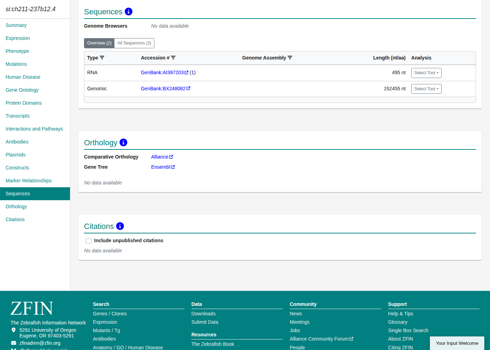

### E6. No location at all (couptf3)

[`ZDB-GENE-000112-32`](https://franklin.zfin.org/ZDB-GENE-000112-32#sequences). "Genome Assembly: Unknown", no browser. Dev genes: 6,164.

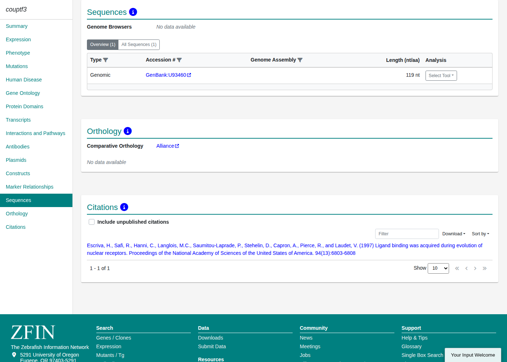

### E7. Pseudogene on GRCz11 only (si:dkey-234l24.4p)

[`ZDB-GENEP-050420-8`](https://franklin.zfin.org/ZDB-GENEP-050420-8#sequences). "Genome Assembly: GRCz11". Sequences shows "Genome Browsers: No data available" and an empty placeholder where the image would be (the tag renders a `GbrowseImage` element with no build). The page reads only `ZFIN` and `NCBILoader` locations, which are GRCz12tu sources. Dev pseudogenes: 4.

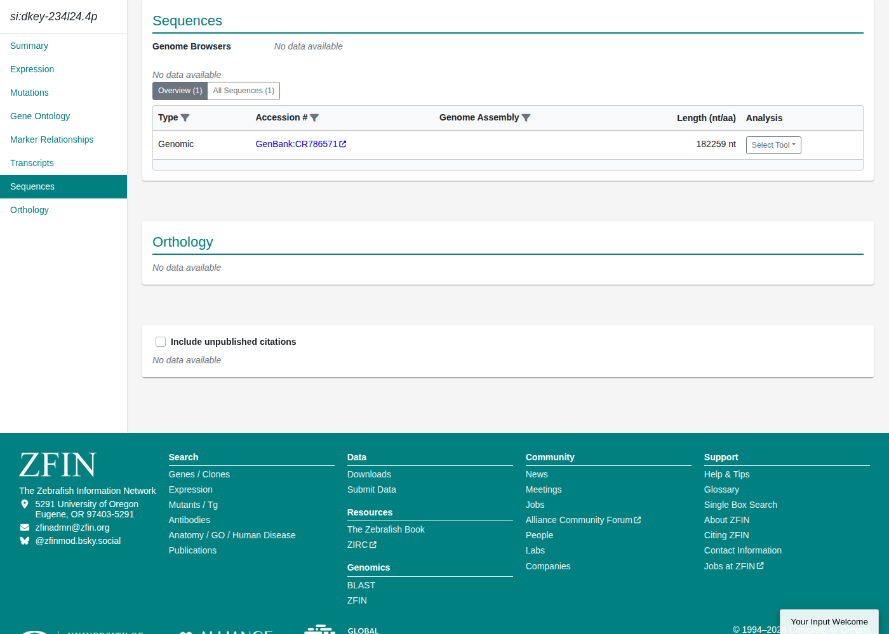

### E8. STR on GRCz11 only: the fallback works (CRISPR2-hk1)

[`ZDB-CRISPR-160128-223`](https://franklin.zfin.org/ZDB-CRISPR-160128-223). One **GRCz11** browser at `13:22969396..23011305`. This is the per-object fallback, the only page that does it. Dev CRISPRs: 19.

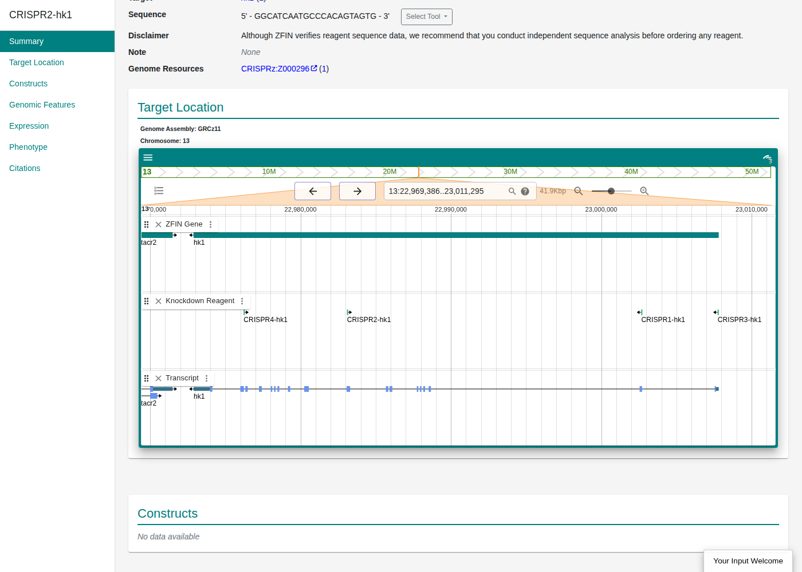

### E9. STR on GRCz12tu only, and STR with no location

[`ZDB-CRISPR-160128-304`](https://franklin.zfin.org/ZDB-CRISPR-160128-304) (CRISPR1-mpzl2a): **GRCz12tu** at `15:51758362..51778387`. [`ZDB-CRISPR-140710-4`](https://franklin.zfin.org/ZDB-CRISPR-140710-4) (CRISPR3-tia1l): no browser. Dev CRISPRs: 15 and 207.

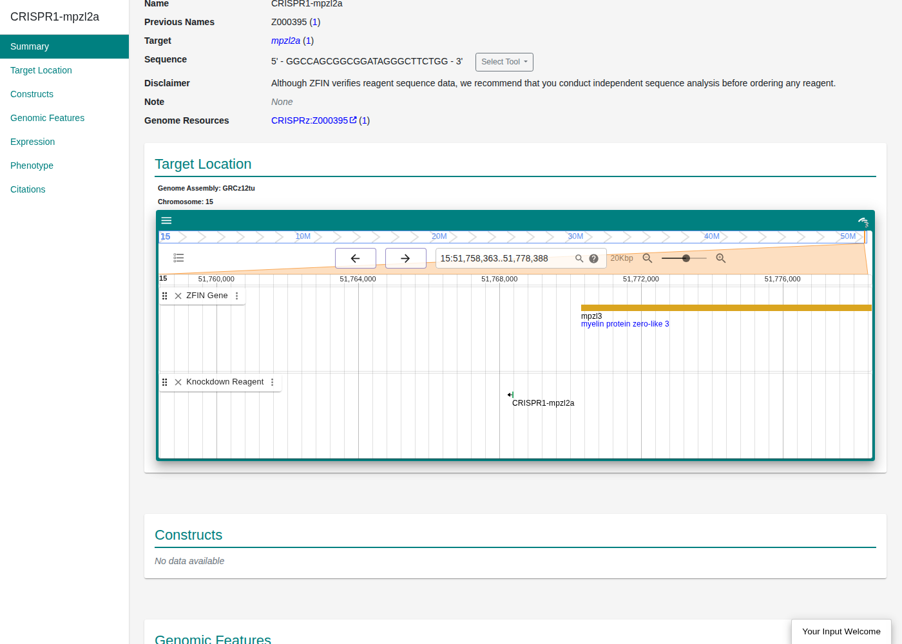
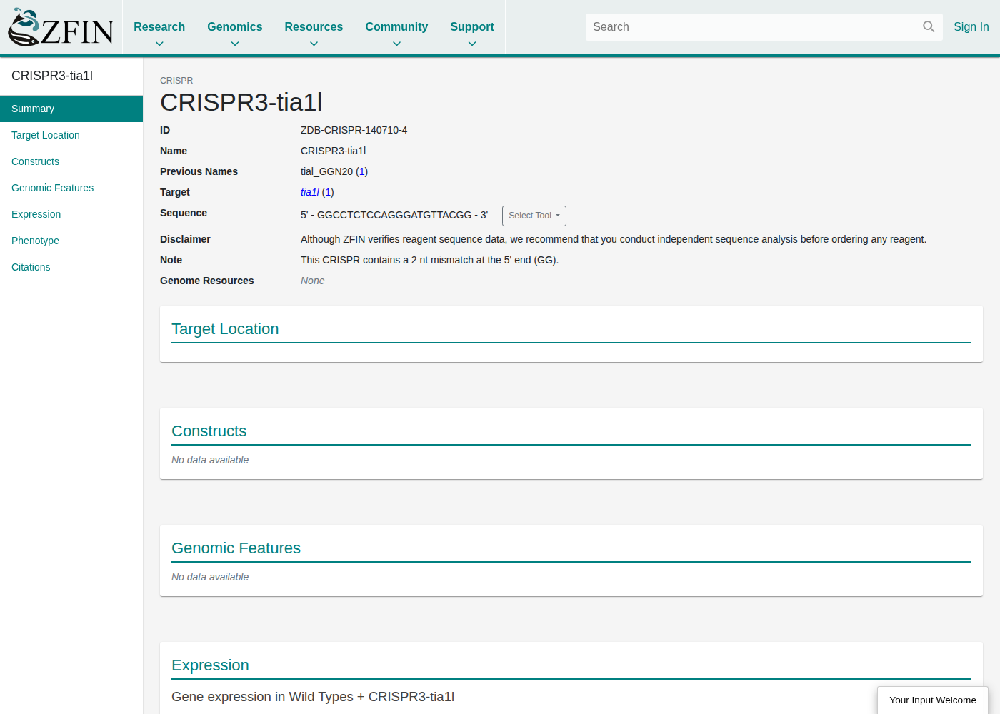

### E10. Feature on Zv9 only draws a Zv9 browser (la010001Tg)

[`ZDB-ALT-120130-1`](https://franklin.zfin.org/ZDB-ALT-120130-1). One browser with build **Zv9** at `16:7529315..7549325`, drawn by the same component from the four-assembly config. Dev features: 9,949.

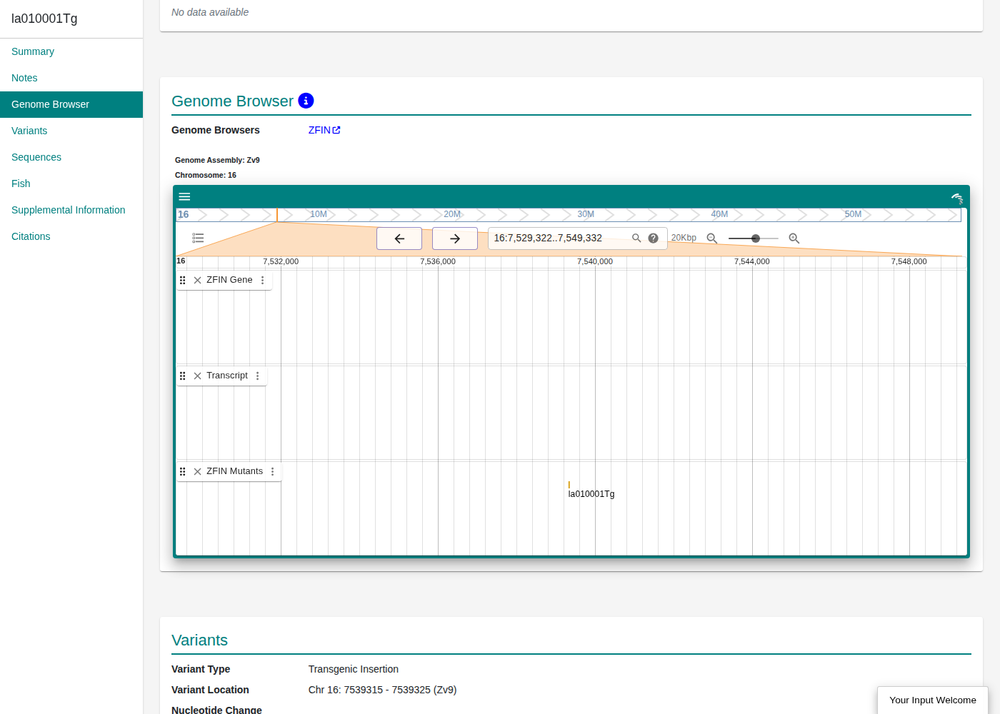

### E11. Feature with a chromosome but no coordinates: no browser (Df(Chr03)c1033)

[`ZDB-ALT-000215-12`](https://franklin.zfin.org/ZDB-ALT-000215-12). "Genome Browser: No data available". In dev its location rows are chromosome-only (`other map location`, `General Load`), with no start or end. Of the 7,713 dev features that are on GRCz11 only, **7,139 look like this** and 574 have coordinates. This corrects an earlier note that GRCz11-only features show a GRCz11 browser.

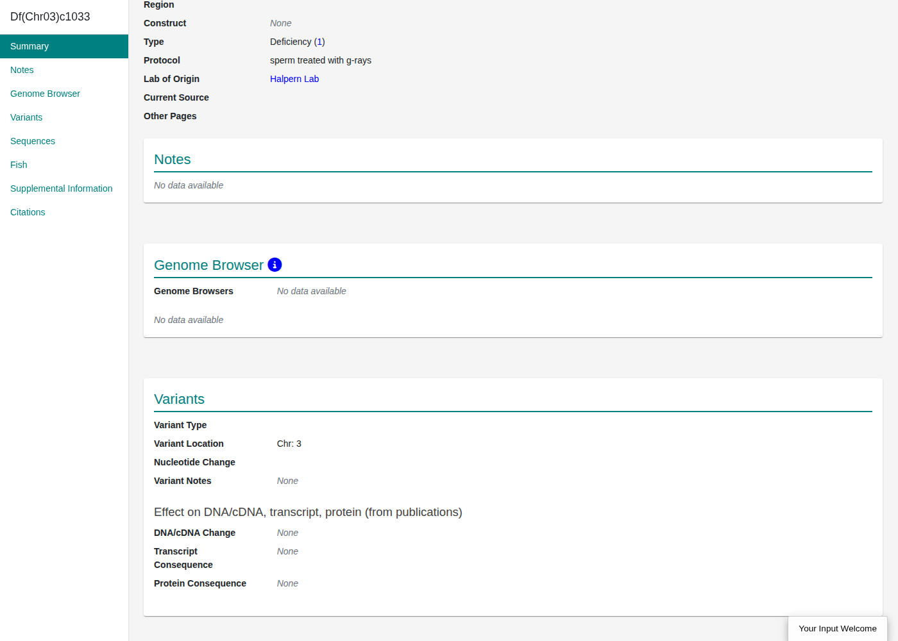

### E12. Feature on GRCz11 only with coordinates (Df(Chr9:...)b476)

[`ZDB-ALT-000712-2`](https://franklin.zfin.org/ZDB-ALT-000712-2). One **GRCz11** browser at `9:28863850..28946029`. The 574 dev features like it are the GRCz11 case that works.

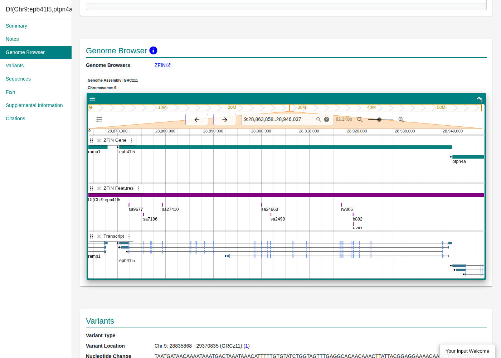

### E13. Feature on GRCz11 and GRCz12tu (i26)

[`ZDB-ALT-000412-8`](https://franklin.zfin.org/ZDB-ALT-000412-8). One **GRCz12tu** browser at `7:30298387..30348928`. The GRCz11 location is not offered. Dev features: 5,876.

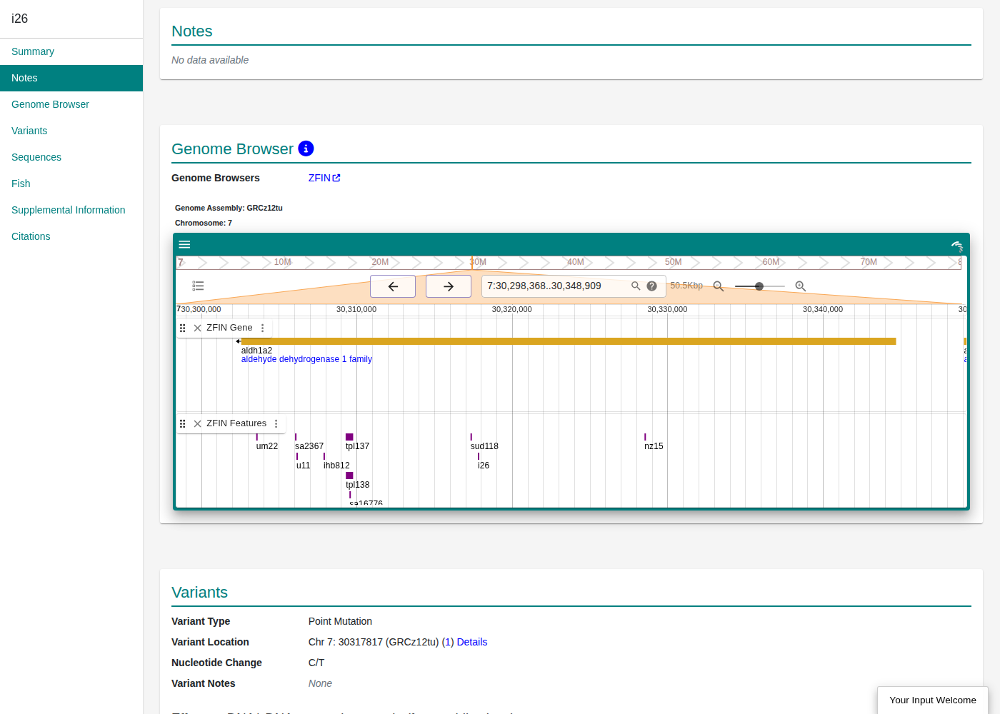

### E14. The "related data" link opens the old JBrowse v1 at the wrong place

[`/action/jbrowse/byName?name=ZDB-GENE-990415-72`](https://franklin.zfin.org/action/jbrowse/byName?name=ZDB-GENE-990415-72) redirects to `/jbrowse/?data=data/GRCz11&name=13:28495419..28501985&tracks=&loc=1:23831764..35747419`. It opens the legacy JBrowse v1 on **GRCz11**, at a region of chromosome 1 (`loc=1:...`) with no track selected, although the redirect names a chromosome 13 location. fgf8a is on GRCz12tu, so this link is on the wrong assembly as well. I did not investigate why the location is wrong.

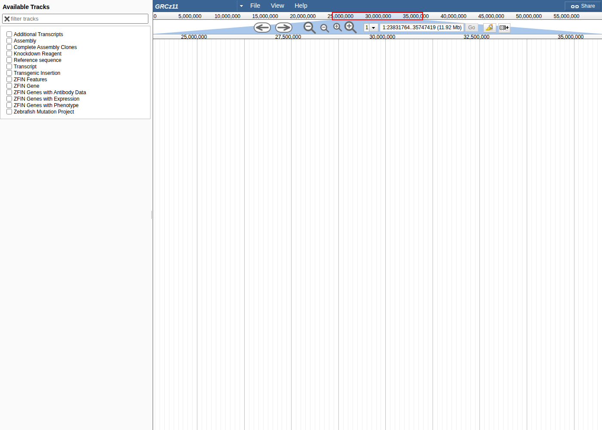

---

## 4. The issues, with their evidence

**1. The gene Sequences browser is tied to the name `GRCz12tu`.** The best assembly must be named GRCz12tu, so a GRCz11-only gene never gets one (E2). Once GRCz13ab data exists, the first gene with a GRCz13ab row gets GRCz13ab as its best assembly (`a_order` 5, below GRCz12tu's 10), and its browser disappears too. Evidence: E2, E3, E4.

**2. "Exactly one landmark" removes the browser from genes that have two.** Evidence: E1 (7 dev genes).

**3. The "Genome Assembly" row comes from a stored copy that has drifted.** bicc1b says GRCz11 on the gene page and shows GRCz12tu on Mapping detail. Evidence: E3. Another 3,497 genes have GRCz11 locations and no row at all, so they say Unknown (E4).

**4. GRCv10 is a leftover label.** It is listed on the Mapping detail page for fgf8a (M3), and genes whose only location is GRCv10 say Unknown (E5). Dev: 62,173 location rows, 23,348 genes. It was added to the `assembly` table as a legacy row (commit `245c6bf06a`).

**5. One page can show two assemblies with nothing connecting them.** fgf8a's Transcripts section is GRCz11 and its Sequences section is GRCz12tu, 3.4 Mb apart (M1, M2). The pseudogene in M4 shows the two on different chromosomes. About 18,971 dev genes have both landmarks.

**6. Each page type has its own rule, and one rule does not fit them all.** Transcripts and clones are fixed on GRCz11 (M2, M5). The STR page chooses per object (E8, E9). Features take the first location (M7, E12, E13). Mapping detail chooses by source (M3, E2, E3). A single "has a browser" flag per assembly cannot express this.

**7. Mapping detail and the gene page disagree.** For 2,067 dev genes (E2) Mapping detail shows a GRCz11 browser and Sequences shows none. For bicc1b the opposite assembly is shown (E3). Mapping detail picks its build from the location's source, so a `ZFIN`-source GRCz13ab row would be drawn on the GRCz12tu genome with GRCz13ab coordinates. This is from reading the code, not an observed case.

**8. The pseudogene page builds the image before checking the assembly.** A GRCz11-only pseudogene gets an empty placeholder and "No data available" (E7). The code also calls `getName()` on the best assembly without a null check; I did not find a pseudogene in dev that triggers it.

**9. Features with no coordinates show nothing, and most GRCz11-only features are like that.** 7,139 of 7,713 (E11). A chromosome-only location is real data that the browser cannot draw.

**10. Two "ZFIN" genome browsers are one click away, on different assemblies.** The navigation link goes to Amplify on GRCz12tu with a fixed location (M9), the footer link goes to `/action/jbrowse2` on GRCz11 (M8, M9). Neither follows the data.

**11. The search "related data" link opens the old JBrowse v1 on GRCz11 at the wrong location with no tracks.** Evidence: E14.

**12. The front end has its own assembly list.** `config-jbrowse2.json` holds GRCz12tu, GRCz11, GRCz10 and Zv9. A page asking for a build that is not in it silently gets the first one. GRCz13ab would need an entry, and tracks that name it.

**13. The link rows name sources only for two assemblies.** `MappingService.getJBrowserBrowserLinks` has cases for GRCz12tu and GRCz11. Any other assembly gets a link with no name.

### What would fix them

Where the evidence points, without deciding anything:

- A setting, per page type, of which assemblies may be shown and in what order, so an admin can switch GRCz13ab on one page type at a time (issues 1, 6, 12).
- The page offers the first of those assemblies on which the object has a landmark, and a toggle for the others when there are several (issues 5, 7). The front-end config already lists several assemblies, which is what a toggle needs.
- The "Genome Assembly" row and the browser read the same data, not a stored copy (issues 3, 7).
- Rules for what counts as a landmark: more than one on an assembly should pick one, not hide the browser (issue 2).

---

## 5. Not captured

- **BLAST results** (item 13). They need a submitted search. The code uses the default build, GRCz12tu.
- **The search result page** that carries the "related data" link. I followed the redirect directly (E14).
- **Legacy GBrowse** pages (`/action/gbrowse`, `/action/gbrowse/GRCz11`, `/action/gbrowse/GRCz10`) and the old JBrowse v1 beyond the redirect target.
- **Transcript pages and the "all target locations" STR page**, which also embed the component (`transcript-view-related-transcripts.jsp`, `sequence-targeting-reagent-target-view.jsp`).
- **TALEN** pages. Dev TALENs behave like CRISPRs and morpholinos.
- **Mobile layouts** and anything behind a login.

## 6. Reproduction notes

- The screenshots are viewport captures after scrolling to the section, so the page header or other sections may appear above or below. The browser tracks load asynchronously; a few extra seconds can matter.
- The JBrowse components read their location from `data-landmark` and their assembly from `data-build`. To list them on any page, run in the console: `[...document.querySelectorAll('.genome-browser-image')].map(e => [e.id, e.dataset.build, e.dataset.landmark])`.
- A component with `id="GbrowseImage"` and an empty build is the placeholder rendered when the page has no image.
