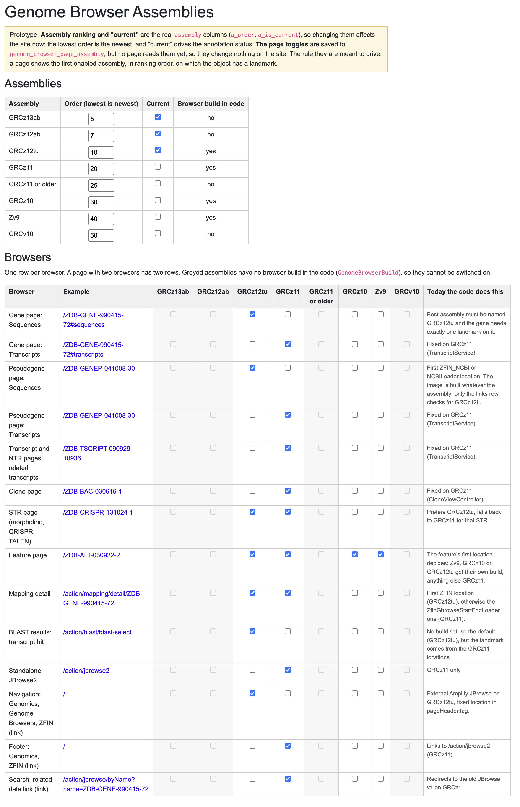

# Which assemblies each genome browser may show: proposed table

Option B from [`handoff-genome-browser-decision.md`](handoff-genome-browser-decision.md), reworked after review. **Status: B was explored with a prototype admin page, which has been reverted (see "The prototype page" below). Options A, C and "A plus a switch" have not been ruled out**, and the decision record in the handoff is still blank. Evidence and screenshots are in [`genome-browser-issues.md`](genome-browser-issues.md) (issue and case numbers below refer to it).

Nothing in this file is implemented. The code, migration and database table of the prototype were removed on 2026-10-28; the notes below describe what it did, and the source is archived in [`prototype-admin-page/`](prototype-admin-page/) as `.txt` files.

## Changes from the first sketch

- **One row per browser, not per page.** The gene and pseudogene pages each have two browsers (Sequences and Transcripts), so each has two rows.
- **No per-page rank column.** The order assemblies are tried in is the global ranking, `assembly.a_order` (lowest is newest). A page shows the first *enabled* assembly in that order on which the object has a landmark.
- **`is_current` is the existing `assembly.a_is_current`.** It is edited on the same page but is not part of the new table.
- **Earlier assemblies do render.** The feature page draws Zv9 and GRCz10 browsers today (E10), so they stay in the Feature row.

```sql
create table genome_browser_page_assembly (
  gpa_slot     text   not null,                          -- key of GenomeBrowserSlot
  gpa_a_pk_id  bigint not null references assembly (a_pk_id),
  primary key (gpa_slot, gpa_a_pk_id)                    -- a row means "on"
);
```

## The rows, as seeded (what the code does today)

Example links are relative to the site root. Assemblies not listed are off. GRCz13ab and GRCz12ab have no browser build in the code, so they cannot be switched on yet.

| Slot | Browser | Example | On for | How the code chooses today |
|---|---|---|---|---|
| `GENE_SEQUENCE` | Gene page, Sequences | [`/ZDB-GENE-990415-72#sequences`](/ZDB-GENE-990415-72#sequences) | GRCz12tu | Best assembly must be named GRCz12tu, and exactly one landmark on it (E1, E2) |
| `GENE_TRANSCRIPTS` | Gene page, Transcripts | [`/ZDB-GENE-990415-72#transcripts`](/ZDB-GENE-990415-72#transcripts) | GRCz11 | Fixed GRCz11 (`TranscriptService`) |
| `PSEUDOGENE_SEQUENCE` | Pseudogene page, Sequences | [`/ZDB-GENEP-041008-30`](/ZDB-GENEP-041008-30) | GRCz12tu | First `ZFIN_NCBI`/`NCBILoader` location; image built whatever the assembly (E7) |
| `PSEUDOGENE_TRANSCRIPTS` | Pseudogene page, Transcripts | [`/ZDB-GENEP-041008-30`](/ZDB-GENEP-041008-30) | GRCz11 | Fixed GRCz11 (`TranscriptService`) |
| `TRANSCRIPT_PAGE` | Transcript and NTR pages, related transcripts | [`/ZDB-TSCRIPT-090929-10936`](/ZDB-TSCRIPT-090929-10936) | GRCz11 | Fixed GRCz11 (`TranscriptService`). Not captured in the screenshots |
| `CLONE` | Clone page | [`/ZDB-BAC-030616-1`](/ZDB-BAC-030616-1) | GRCz11 | Fixed GRCz11 (`CloneViewController`) |
| `STR` | STR page (morpholino, CRISPR, TALEN) | [`/ZDB-CRISPR-131024-1`](/ZDB-CRISPR-131024-1) | GRCz12tu, GRCz11 | GRCz12tu if the STR has a location there, else GRCz11 (E8, E9) |
| `FEATURE` | Feature page | [`/ZDB-ALT-030922-2`](/ZDB-ALT-030922-2) | GRCz12tu, GRCz11, GRCz10, Zv9 | The feature's first location: Zv9, GRCz10 and GRCz12tu get their own build, anything else GRCz11 (M7, E10 to E13) |
| `MAPPING_DETAIL` | Mapping detail | [`/action/mapping/detail/ZDB-GENE-990415-72`](/action/mapping/detail/ZDB-GENE-990415-72) | GRCz12tu, GRCz11 | First `ZFIN` location (GRCz12tu), else the GBrowse-loader one (GRCz11) (E3) |
| `BLAST_HIT` | BLAST results, transcript hit | [`/action/blast/blast-select`](/action/blast/blast-select) (run a search) | GRCz12tu | **Not displayed.** The mapper builds an image but no page renders it (see the notes below) |
| `JBROWSE2_STANDALONE` | Standalone JBrowse2 | [`/action/jbrowse2`](/action/jbrowse2) | GRCz11 | GRCz11 only (M8) |
| `NAV_LINK` | Navigation link, Genomics, Genome Browsers, ZFIN | every page | GRCz12tu | External Amplify, GRCz12tu, fixed location (M9) |
| `FOOTER_LINK` | Footer link, Genomics, ZFIN | every page | GRCz11 | Goes to `/action/jbrowse2` (M9) |
| `RELATED_DATA_LINK` | Search "related data" link | [`/action/jbrowse/byName?name=ZDB-GENE-990415-72`](/action/jbrowse/byName?name=ZDB-GENE-990415-72) | GRCz11 | Redirects to old JBrowse v1 (E14, a separate bug) |

## Where the table would change behavior if a page read it

The seed matches the code on every row except these:

- **Feature.** Today the first location decides, so a feature on GRCz11 and GRCz10 draws GRCz11 only if its first location is GRCz11. With the table it would always draw the newest enabled assembly it has a landmark on.
- **Gene Sequences.** Today a gene whose best assembly is GRCz11 gets no browser. With the table it would also get one on GRCz12tu if it has a landmark there, whatever its stored "best assembly".
- **Link rows (nav, footer, related data).** These are static markup or a redirect. The table would only document them until each is changed to read it.

## The prototype page (reverted)



It lived at `/action/devtool/genome-browser-assemblies`, linked from the developer tools home, and showed two tables:

- **Assemblies.** Every `assembly` row with an editable order (`a_order`), a "current" checkbox (`a_is_current`) and a read-only "Browser build in code" column. Those two columns are the real ones, so edits took effect on the site (ranking, annotation status).
- **Browsers.** One row per browser (the table above), with a checkbox for each assembly, an example link and a note on how the code chooses today. An assembly with no `GenomeBrowserBuild` entry had its checkboxes greyed out. Toggles were saved to `genome_browser_page_assembly` but no page read them, so they changed nothing on the site.

Pieces, all archived in [`prototype-admin-page/`](prototype-admin-page/):

| File | What it was |
|---|---|
| `GenomeBrowserSlot.java.txt` | An enum of the 14 browsers: key, label, link or embedded, example URL, how the code chooses today |
| `GenomeBrowserAssemblyController.java.txt` | `GET .../data` (assemblies, slots, enabled flags), `POST .../assembly` (order, current), `POST .../toggle`; native SQL, no entity |
| `genome-browser-assemblies.jsp.txt` | One page of plain JavaScript that fetches the data and re-renders after each save |
| `0090-genome-browser-page-assembly.sql.txt` | Creates the table and seeds 19 rows from what the code does today (idempotent) |
| `home.jsp.diff.txt` | The one-line link added to the developer tools home |

To bring it back, copy the files in place without the `.txt`, restore the `home.jsp` link, and run the migration. The screenshot was taken before the BLAST correction below, so its BLAST row still shows the old description.

## Notes from the review conversation (2026-10-28)

### What "no browser build" means on the prototype page

The "Browser build in code" column is `GenomeBrowserBuild.forAssembly(name).isPresent()`, so it only checks that the Java enum has an entry for the assembly. A drawable assembly also needs entries in `GenomeBrowserTrack.trackMap` and in the front-end `config-jbrowse2.json`. The check does not look at those two, so an assembly with an enum entry but no tracks would look available and still draw an empty browser. That is the "browser with no tracks" risk the handoff lists against B.

### Rows on the assembly list that are not genome releases

- **`GRCz11 or older`** (`a_pk_id` 4, order 25, no GCF identifier) was created with the `assembly` table (`1171/assembly-ncbi.sql`). `NCBIGff3PostProcessor.generateGRCz11OrOlderAssemblies` gives it to genes that have a Vega link and no Ensembl link, so no assembly could be worked out. Nothing uses it in the dev database: `marker_assembly` has 0 rows for it and no location row carries it.
- **`GRCv10`** (order 50) is the legacy label added by `0070-grcv10-legacy-assembly.sql`.

Neither can have a browser. Whether the prototype page should hide them is undecided.

### Direction: move the browser data from code to the database

Stated by the user. Eventually `GenomeBrowserBuild` (builds and paths), `GenomeBrowserTrack.trackMap` (track ids), the page-to-tracks lists and the per-page assembly choice should live in tables, and ideally the front-end `config-jbrowse2.json` too (it would need an endpoint that serves it). The prototype table is the first of these. One layout, extending option A:

| Table | Replaces | Holds |
|---|---|---|
| `assembly` (exists) | | name, order, current |
| `genome_browser_build` | `GenomeBrowserBuild` enum | one row per assembly: JBrowse data path, display name |
| `genome_browser_track` | `trackMap` | `(assembly, logical track, track id)`, 11 rows today |
| `genome_browser_page_track` | `GenomeBrowserTrack.Page` | `(slot, logical track)` |
| `genome_browser_page_assembly` (prototype) | the per-page choices | `(slot, assembly)` |

"Has a browser" would then be a query (a build row and a track row exist), which removes the weakness above. Nothing beyond the prototype table is built.

### Examples for the two rows that look wrong today

**Pseudogene Sequences image** (built before any assembly check; `PseudoGeneViewController`):

- [`/ZDB-GENEP-050420-8`](/ZDB-GENEP-050420-8) (si:dkey-234l24.4p) is the failing case (E7). Its only location is GRCz11, so Sequences says "No data available" and renders an empty image placeholder.
- [`/ZDB-GENEP-041008-30`](/ZDB-GENEP-041008-30) is the working case, on GRCz12tu and GRCz11 (M4).

**BLAST transcript hit** (`BlastResultMapper`, about line 375). This is **not a live problem: the BLAST results page never shows a genome browser.**

The mapper builds an image for a transcript hit from `Vega_Trans` (an `OTTDART` accession) with a related gene. It sets no build (the default, GRCz12tu) and takes the landmark from the GRCz11 locations, which would be a mismatch. But it stores the image on `HitViewBean.gbrowseImage`, and no JSP or tag under `blast/` reads that property.

Checked on production, 2026-10-28, with a result page for `OTTDART00000015725` (spon1a-201) searched against "ZFIN Genes With Expression" and "ZFIN RNA/cDNA": `https://franklin.zfin.org/action/blast/blast-view?resultFile=blast3251276628810801635.xml`. The page has the OTTDART hit, the Vega and Ensembl_Trans links and the gene column, and no browser component. Its only genome browser link is the footer one to `/action/jbrowse2`. (That result file expires after a week.) The only other `blast` code touching the image is `HitViewBean`'s getter and setter.

Consequences for the table: the `BLAST_HIT` row has no effect and could be removed, along with the mapper code, unless BLAST pages are meant to show a browser again. The earlier guidance on posting a query to get a hit page with an image is wrong, since no query produces one. Issue 13 in `genome-browser-issues.md` ("BLAST results (transcript hits)", item 13 in section 1) should read "built but never displayed".
